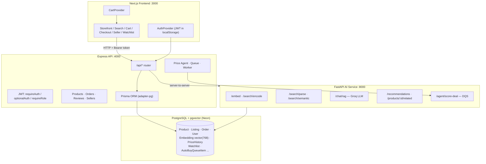

# Amora — AI-Powered Tech E-Commerce


**Amora** is a full-stack, AI-driven e-commerce platform for tech products (laptops, phones, audio, smart home). It combines a modern Next.js storefront, an Express + Prisma marketplace API, a Python FastAPI AI service, and a PostgreSQL database with `pgvector` — delivering semantic search, a RAG shopping assistant, personalized recommendations, and a sandboxed price-watching agent.

> The customer-facing UI is in Vietnamese. This documentation is in English.

---

## Table of Contents

- [Overview](#overview)
- [Key Features](#key-features)
- [Architecture](#architecture)
- [Tech Stack](#tech-stack)
- [Project Structure](#project-structure)
- [Prerequisites](#prerequisites)
- [Getting Started](#getting-started)
  - [1. Clone the repository](#1-clone-the-repository)
  - [2. Configure environment variables](#2-configure-environment-variables)
  - [3. Install dependencies](#3-install-dependencies)
  - [4. Set up the database](#4-set-up-the-database)
  - [5. Seed the data](#5-seed-the-data)
  - [6. Run all three services](#6-run-all-three-services)
- [Environment Variables](#environment-variables)
- [Database Schema](#database-schema)
- [API Reference](#api-reference)
- [AI Features in Depth](#ai-features-in-depth)
- [Evaluation Results](#evaluation-results)
- [Available Scripts](#available-scripts)
- [Troubleshooting](#troubleshooting)
- [Known Issues & Tech Debt](#known-issues--tech-debt)
- [Documentation](#documentation)
- [Security Notes](#security-notes)
- [Contributing](#contributing)
- [Acknowledgements](#acknowledgements)

---

## Overview

Amora is organized as four independently running components that communicate over HTTP/REST:

| Component | Stack | Port | Responsibility |
|-----------|-------|------|----------------|
| **Frontend** | Next.js (App Router), React 19, Tailwind CSS 4, shadcn/ui | `3000` | Storefront, product pages, search, cart, checkout, seller dashboard, watchlist |
| **Backend API** | Express 5 (TypeScript), Prisma 7, JWT, Swagger | `4000` | Auth, products, orders, sellers, search orchestration, price agent, background worker |
| **AI Service** | FastAPI (Python 3.11+), Sentence-Transformers, Groq LLM | `8000` | Embeddings, semantic search, RAG chat, Deal Quality Score, recommendations |
| **Database** | PostgreSQL (Neon) + `pgvector` | — | Products, orders, users, embeddings, price history |

The frontend talks **only** to the Backend. The Backend proxies AI calls server-to-server (`AI_URL`) so the browser never hits the AI service directly — avoiding CORS issues and keeping AI failures fail-safe.

---

## Key Features

### 🔍 Hybrid Search
- Natural-language search over Vietnamese queries.
- Combines PostgreSQL Full-Text Search (`pg_trgm`, `unaccent`) with `pgvector` cosine similarity.
- Results fused using **Reciprocal Rank Fusion (RRF, k=60)**.
- Typo-tolerance via trigram similarity (> 0.3) and diacritic-insensitive matching.
- Exact-name substring boost (+1000) keeps exact matches on top.
- Filters: brand, category, price range; results cached in-memory (TTL 300s).

### 💬 RAG Shopping Assistant
- Context-aware chat with product grounding and category/price memory across turns.
- **Anti-hallucination:** skips the LLM and answers honestly when hard filters match no products.
- LLM: `qwen/qwen3.8-27b` via Groq's OpenAI-compatible API.

### 🛒 Full Checkout Flow
- Cart persisted in `localStorage` via `CartProvider`.
- Multi-step checkout (shipping info → payment method).
- Cash-on-Delivery (COD) and VNPay support.
- Flat 30,000 VND shipping fee; stock decremented on order creation.

### 📊 Seller Dashboard
- Real-time revenue, order, and listing statistics.
- Order management with status transitions.
- Seller **Create Product** flow (`/seller/create-product`) backed by `POST /api/products`.

### 🎯 Personalized Recommendations
- Weighted-average user embedding from interactions (`view`, `click`, `add_to_cart`, `purchase`).
- Cosine nearest-neighbor retrieval, excluding already-interacted products.
- Rule-based explanations (no LLM): brand match, category match, budget fit, or generic.
- Popular-products fallback when a user has fewer than 3 interactions or the AI service is down.

### 🔗 Related Products
- "Similar products" section on the product detail page.
- Cosine similarity of embeddings, top 4, excluding the original and duplicate names.
- Fetched through the Backend proxy (`GET /api/products/:id/related`) with fail-safe empty results.

### 🤖 Price Agent & Auto-buy Worker
- **Deal Quality Score (DQS 0–100):** discount (40) + price history (40) + rating (20).
- Threshold `dqs >= 70` marks a deal.
- Watchlist with target prices and a per-user auto-buy toggle.
- Background worker scans watchlist hits and executes **sandbox** orders (`status='sandbox'`, no real payment).

### 📝 Interaction Logging
- Client logs `view`, `click`, `add_to_cart`, and `purchase` events.
- Token-gated: authenticated users log under their own ID; anonymous traffic uses the shared mock buyer.

---

## Architecture



**Data flow highlights**

- **Frontend → Backend only.** `NEXT_PUBLIC_API_URL` points to port `4000`. The Backend calls `AI_URL` (port `8000`) with a timeout (`AI_TIMEOUT_MS`).
- **AI calls are fail-safe.** If the AI service is unavailable or times out, endpoints degrade gracefully (popular products, empty related products) instead of surfacing an error.

---

## Tech Stack

| Layer | Technologies |
|-------|--------------|
| **Frontend** | Next.js 16 (App Router, Turbopack, Cache Components), React 19, TypeScript 5, Tailwind CSS 4, shadcn/ui, lucide-react, recharts |
| **Backend** | Node.js, Express 5, TypeScript, Prisma 7 + `@prisma/adapter-pg`, `jsonwebtoken`, `bcryptjs`, `helmet`, `express-rate-limit`, `node-cache`, `swagger-ui-express` |
| **AI Service** | Python 3.11+, FastAPI, Uvicorn, Pydantic, Sentence-Transformers (`keepitreal/vietnamese-sbert`, 768-dim), PyTorch, OpenAI SDK → Groq |
| **Database** | PostgreSQL on Neon, `pgvector` (HNSW, cosine), `pg_trgm`, `unaccent` |
| **Auth** | JWT HS256 (Bearer token) + httpOnly role cookie for seller route middleware |
| **Docs** | OpenAPI/Swagger (`backend/openapi.yaml`, served at `/docs`) |

---

## Project Structure

```text
e-Amora/
├── src/                        # Next.js frontend
│   ├── app/                    # App Router pages
│   │   ├── page.tsx            # Home
│   │   ├── products/[id]/      # Product detail
│   │   ├── search/             # Search & filters
│   │   ├── cart/               # Cart
│   │   ├── checkout/           # Checkout
│   │   ├── login/              # Buyer login
│   │   ├── watchlist/          # Price Agent dashboard
│   │   └── seller/             # Seller dashboard, login, create-product
│   ├── components/             # layout/, shared/, pages/, ui/ (shadcn)
│   ├── context/                # AuthProvider, CartProvider
│   ├── hooks/                  # useDebounce
│   ├── lib/                    # helpers, logInteraction, utils
│   └── types/                  # Shared TypeScript types
│
├── backend/                    # Express + Prisma API
│   ├── src/index.ts            # Single server entry point (routes, worker, middleware)
│   ├── prisma/
│   │   ├── schema.prisma       # Data models
│   │   └── migrations/         # SQL migrations (FTS, pgvector, agent, ...)
│   ├── scripts/                # DB helper scripts
│   ├── openapi.yaml            # Swagger spec (served at /docs)
│   └── .env.example
│
├── AI_features/                # FastAPI AI service
│   ├── main.py                 # All AI endpoints
│   ├── requirements.txt
│   ├── convert_data.py         # Prepare mock data
│   ├── seed_db.py              # Seed products + embeddings
│   ├── seed_price_history.py   # 30-day price history
│   └── .env.example
│
├── docs/                       # Architecture, API contract, evaluation, known issues
│   └── eval/results/           # Measured evaluation JSON
├── eval/                       # Evaluation scripts (search, recs, RAG, price agent)
├── middleware.ts               # Protects /seller/* routes
├── next.config.ts              # Image host whitelist, caching headers
├── .env.example
├── AGENTS.md                   # AI-assisted development guidelines
└── CHANGELOG.md
```

---

## Prerequisites

- **Node.js** 20+ (Next.js 16 requires a modern LTS)
- **Python** 3.11+
- **PostgreSQL** with the `pgvector` extension (a [Neon](https://neon.tech) database is recommended)
- **Groq API key** for the RAG chatbot (`GROQ_API_KEY`)

> **Disk / first-run note:** the AI service downloads the `keepitreal/vietnamese-sbert` model (~hundreds of MB) on first start and may take a while.

---

## Getting Started

### 1. Clone the repository

```bash
git clone <your-repository-url>
cd e-Amora
```

### 2. Configure environment variables

The project uses **three separate `.env` files** (one per service). Copy each example and fill in real values.

**Root `.env`** — used by the Next.js frontend:

```dotenv
DATABASE_URL="postgresql://<user>:<password>@<host>/<db>?sslmode=require&channel_binding=require"
NEXT_PUBLIC_API_URL="http://localhost:4000"
AI_URL="http://localhost:8000"
AI_TIMEOUT_MS="10000"
```

**`backend/.env`** — used by the Express API:

```dotenv
DATABASE_URL="postgresql://<user>:<password>@<host>/<db>?sslmode=require&channel_binding=require"
PORT=4000
AI_URL="http://localhost:8000"
AI_TIMEOUT_MS="10000"
JWT_SECRET="<your_jwt_secret_min_32_bytes>"
JWT_EXPIRES_IN="7d"
CORS_ORIGINS=""
TRUST_PROXY_HOPS="0"

# Price Agent worker (optional)
AUTO_BUY_WORKER_ENABLED="true"
AUTO_BUY_WORKER_INTERVAL_MS="10000"
AUTO_BUY_WORKER_BATCH_SIZE="10"
```

**`AI_features/.env`** — used by the FastAPI service:

```dotenv
DATABASE_URL="postgresql://<user>:<password>@<host>/<db>?sslmode=require&channel_binding=require"
GROQ_API_KEY="<your_groq_key>"
```

> ⚠️ **Never commit real `.env` files or secrets.** Only `.env.example` is tracked. See [Security Notes](#security-notes).

### 3. Install dependencies

```bash
# Frontend
npm install

# Backend
cd backend && npm install && cd ..

# AI service
cd AI_features
python -m venv .venv
# Windows: .venv\Scripts\activate
source .venv/bin/activate          # macOS / Linux
pip install -r requirements.txt

# Optional: eval dependencies (pandas, requests, openai, psycopg2-binary)
pip install pandas requests openai psycopg2-binary
cd ..
```

### 4. Set up the database

Apply Prisma migrations (includes `pgvector`, `pg_trgm`, `unaccent`, FTS and HNSW indexes):

```bash
cd backend
npx prisma migrate deploy
# or, for a fresh local database during development:
npx prisma db push
```

### 5. Seed the data

Run from `AI_features/` with the virtual environment activated:

```bash
cd AI_features

# Prepare mock product data
python convert_data.py

# Insert users, categories, products, listings, and 768-dim embeddings
python seed_db.py

# Generate 30 days of price history (used by the Price Agent / DQS)
python seed_price_history.py
```

> **Safety:** seeding writes to the database pointed to by `DATABASE_URL`. Confirm it is a development database before running.

### 6. Run all three services

Start each in its own terminal.

**Terminal 1 — AI Service (port 8000)**

```bash
cd AI_features
# Windows: .venv\Scripts\activate
source .venv/bin/activate
uvicorn main:app --reload --port 8000
```

**Terminal 2 — Backend API (port 4000)**

```bash
cd backend
npm run dev
```

**Terminal 3 — Frontend (port 3000)**

```bash
npm run dev
```

Then open **http://localhost:3000**.

> All three services must be running for full functionality (search, chat, recommendations, price agent, checkout).

---

## Environment Variables

| Variable | Service | Default | Description |
|----------|---------|---------|-------------|
| `DATABASE_URL` | Backend, AI | — | PostgreSQL connection string (Neon, `sslmode=require`) |
| `PORT` | Backend | `4000` | API port |
| `NEXT_PUBLIC_API_URL` | Frontend | `http://localhost:4000` | Backend base URL used by the browser |
| `AI_URL` | Backend | `http://localhost:8000` | AI service base URL (server-to-server) |
| `AI_TIMEOUT_MS` | Backend | `10000` | Timeout for AI calls (ms) |
| `JWT_SECRET` | Backend | dev fallback | JWT signing key (≥ 32 bytes in production) |
| `JWT_EXPIRES_IN` | Backend | `7d` | Token lifetime |
| `CORS_ORIGINS` | Backend | *(allow all in dev)* | Comma-separated allowed origins |
| `TRUST_PROXY_HOPS` | Backend | `0` | Express `trust proxy` setting |
| `AUTO_BUY_WORKER_ENABLED` | Backend | `false` | Enable the auto-buy worker (`true`/`false`) |
| `AUTO_BUY_WORKER_INTERVAL_MS` | Backend | `10000` | Worker interval (min 1000 ms) |
| `AUTO_BUY_WORKER_BATCH_SIZE` | Backend | `10` | Items processed per tick (1–100) |
| `GROQ_API_KEY` | AI | — | Groq API key for the RAG chatbot |

---

## Database Schema

All models live in `backend/prisma/schema.prisma`. Key tables:

| Model | Purpose |
|-------|---------|
| `User` | Accounts (`buyer` / `seller`), `autoBuyEnabled` flag |
| `Shop` | Seller storefront |
| `Category` | Product categories |
| `Product` | Core product (price, specs, images, brand, rating, tags) |
| `Listing` | Per-shop offer with price, stock, condition |
| `Order` / `OrderItem` | Orders and line items (`status` includes `sandbox`) |
| `Review` | Product ratings and comments |
| `Interaction` | User actions (`view`, `click`, `add_to_cart`, `purchase`) |
| `Embedding` | 768-dim product vector (`vector(768)`) |
| `PriceHistory` | Historical listing prices (used by DQS) |
| `Watchlist` / `AutoBuyQueueItem` | Price Agent targets and queue |
| `SearchSession` / `SearchClick` | Search analytics |
| `ChatMessage` | RAG conversation history |

Indexes include `pg_trgm`/GIN for FTS, a trigram index for typo tolerance, and an HNSW index (`vector_cosine_ops`) for vector search.

---

## API Reference

Full details: [`docs/API_CONTRACT.md`](./docs/API_CONTRACT.md) and Swagger UI at `http://localhost:4000/docs`.

### Backend (Express, `:4000`)

| Method | Endpoint | Auth | Description |
|--------|----------|------|-------------|
| `POST` | `/api/auth/register` | — | Register (`buyer` / `seller`) |
| `POST` | `/api/auth/login` | — | Login, returns JWT |
| `GET` | `/api/auth/me` | Bearer | Current user |
| `GET` | `/api/products` | — | List/filter products |
| `GET` | `/api/products/:id` | — | Product detail + offers |
| `GET` | `/api/products/:id/price-history` | — | Price history & trend |
| `GET` | `/api/products/:id/reviews` | — | Product reviews |
| `POST` | `/api/products/:id/reviews` | Buyer | Create review |
| `GET` | `/api/products/:id/related` | — | Related products (proxy to AI, fail-safe) |
| `POST` | `/api/products` | Seller | Create product |
| `POST` | `/api/orders` | Buyer | Create order (COD / VNPay) |
| `GET` | `/api/orders/me` | Buyer | Order history |
| `GET` | `/api/orders/:id` | Bearer | Order detail |
| `PATCH` | `/api/orders/:id/status` | Seller | Update order status |
| `GET` | `/api/search/hybrid` | — | Hybrid keyword + vector search (RRF) |
| `POST` | `/api/interactions` | Optional | Log an interaction |
| `POST` | `/api/search/sessions` | Optional | Create search session |
| `POST` | `/api/search/sessions/:id/clicks` | Optional | Log a search click |
| `GET` | `/api/recommendations` | Bearer | Personalized feed (AI + fallback) |
| `POST` | `/api/agent/watch` | Buyer | Add to watchlist |
| `DELETE` | `/api/agent/watch/:id` | Buyer | Remove from watchlist |
| `GET`/`PUT` | `/api/agent/rules` | Buyer | Auto-buy rule |
| `POST`/`GET` | `/api/agent/queue` | Buyer | Enqueue / list auto-buy jobs |
| `POST` | `/api/agent/queue/:id/execute` | Buyer | Execute a sandbox auto-buy |
| `GET` | `/api/agent/history` | Buyer | Watchlist + orders history |
| `GET` | `/api/seller/listings` | Seller | Seller listings |
| `GET` | `/api/seller/orders` | Seller | Seller orders |
| `GET` | `/api/seller/stats` | Seller | Revenue & order stats |
| `GET` | `/health` | — | DB health check |

### AI Service (FastAPI, `:8000`)

| Method | Endpoint | Description |
|--------|----------|-------------|
| `GET` | `/health` | Health check |
| `POST` | `/embed` | Batch text → 768-dim embeddings |
| `POST` | `/search/encode` | Query → 768-dim vector |
| `POST` | `/search/parse` | Extract hard filters from natural language |
| `POST` | `/search/semantic` | Semantic search |
| `POST` | `/chat/rag` | RAG chat (Groq `qwen/qwen3.8-27b`) |
| `POST` | `/agent/score-deal` | Deal Quality Score (0–100) |
| `GET` | `/products/{id}/related` | Top-4 related products |
| `POST` | `/recommendations` | Personalized recommendations |

---

## AI Features in Depth

### Hybrid Search (keyword + vector + RRF)

1. Backend sends the query to `POST /search/encode` → 768-dim vector.
2. PostgreSQL runs two candidate queries:
   - **Keyword:** FTS via `to_tsvector` + `similarity()` (trigram > 0.3), top 50.
   - **Vector:** cosine nearest neighbors via pgvector, top 50.
3. Results are fused with RRF: `10/(60+kw_rank) + 1/(60+vec_rank)`.
4. Exact-name matches receive a `+1000` boost.
5. Results are cached in-memory for 300 seconds.

### Personalized Recommendations

- Uses the last 50 interactions; below 3 interactions → popular fallback.
- `user_vector = weighted average(view=1, click=2, add_to_cart=5, purchase=10)`.
- Excludes already-interacted products; returns top-K with a rule-based `explanation`.
- Backend caps `limit` at 50 (default 12) and falls back to popular products if AI fails.

### RAG Chatbot

- Parses Vietnamese filters (price units: `triệu`, `tr`, `củ`, `k`, `nghìn`, `ngàn`).
- Retains category context across turns.
- **Anti-hallucination:** if hard filters match no products, the LLM is skipped and an honest answer is returned.
- Returns `{ answer, products, groundedness_score }` (groundedness currently hardcoded `0.95`).

### Price Agent & Deal Quality Score (DQS)

DQS is computed in `AI_features/main.py`:

| Component | Points | Rule |
|-----------|--------|------|
| Discount | 40 | ≥ 20% → 40; ≤ 5% → 0; linear in between |
| History | 40 | `currentPrice ≤ min*1.05` → 40; `≥ max` → 0; no history → 20 |
| Rating | 20 | ≥ 4.5 → 20; ≤ 3.0 → 0; linear in between |

- `dqs = round(discount + history + rating)`, clamped to 0–100; `is_deal = dqs >= 70`.
- The auto-buy worker processes pending queue items, checks `autoBuyEnabled`, active watchlist, `dqs ≥ 70`, and `currentPrice ≤ targetPrice`, then creates a **sandbox** order.
- Sandbox orders never charge money; they exist to simulate the decision.

---

## Evaluation Results

Measured on the development dataset (see [`docs/EVALUATION_PLAN.md`](./docs/EVALUATION_PLAN.md) and `docs/eval/results/`).

### Semantic Search (`/api/search/hybrid`)

| Mode | Hit Rate @10 | MRR | NDCG @10 | Avg Latency |
|------|--------------|-----|----------|-------------|
| Keyword | 0.4286 | 0.4286 | 0.4286 | 318.68 ms |
| Vector | 0.1429 | 0.0179 | 0.0451 | 217.96 ms |
| Hybrid (RRF) | 0.5714 | 0.2798 | 0.3687 | 424.46 ms |

### RAG Chatbot (LLM-as-a-judge, `qwen/qwen3.8-27b`)

| Metric | Score |
|--------|-------|
| Average faithfulness | 4.6 / 5 |
| Average relevancy | 4.4 / 5 |
| Average overall | **4.5 / 5** |

### Price Agent (`/agent/score-deal`)

| Metric | Value |
|--------|-------|
| Scenarios executed | 3 |
| Correct activations | 3 / 3 (100%) |
| Avg latency | 2332.59 ms |
| p95 latency | 2382.44 ms |

> Sample sizes are small and reflect the current development dataset; treat them as indicative, not production benchmarks.

---

## Available Scripts

### Frontend (`/`)

| Command | Description |
|---------|-------------|
| `npm run dev` | Start Next.js dev server (Turbopack) |
| `npm run build` | Production build + type check |
| `npm run start` | Start production server |
| `npm run lint` | Run ESLint |

### Backend (`backend/`)

| Command | Description |
|---------|-------------|
| `npm run dev` | Start Express API with `ts-node` |
| `npx tsc --noEmit` | Type-check without emitting |
| `npx prisma migrate deploy` | Apply migrations |
| `npx prisma db push` | Push schema to the database |
| `npx prisma studio` | Open Prisma Studio |

### AI Service & Data (`AI_features/`)

| Command | Description |
|---------|-------------|
| `uvicorn main:app --reload --port 8000` | Run the AI service |
| `python convert_data.py` | Prepare mock data |
| `python seed_db.py` | Seed products + embeddings |
| `python seed_price_history.py` | Generate 30-day price history |
| `python migrate_multi_vendor.py` | Multi-vendor migration helper |

### Evaluation (`eval/`)

| Command | Description |
|---------|-------------|
| `python eval_search.py` | Search metrics (Hit Rate, MRR, NDCG, latency) |
| `python eval_recommendation.py` | Recommendation diversity/novelty |
| `python eval_rag.py` | RAG faithfulness/relevancy (LLM judge) |
| `python eval_price_agent.py` | DQS accuracy and latency |

---

## Troubleshooting

| Symptom | Likely cause | Fix |
|---------|--------------|-----|
| `Failed to fetch` on product pages | Frontend calling AI service directly / CORS | Ensure components call `NEXT_PUBLIC_API_URL` (Backend), not `AI_URL` |
| `hostname "..." is not configured under images` | Remote image host missing from `next.config.ts` | Add the host to `images.remotePatterns` and restart `npm run dev` |
| AI endpoints time out on first call | Sentence-Transformers model still loading | Increase `AI_TIMEOUT_MS` (default `10000`) |
| `P2028: commit on expired transaction` | Neon cold start exceeding Prisma timeout | Already mitigated (`maxWait: 10s`, `timeout: 15s`); retry |
| Prisma can't connect | `DATABASE_URL` missing/incorrect | Verify the connection string and `sslmode=require` |
| Seller routes redirect to login | Missing `eamora.auth.token` cookie | Log in at `/seller/login` |
| Search returns weak results | Missing embeddings / truncated names | Re-run `seed_db.py`; see [Known Issues](#known-issues--tech-debt) |

> `next.config.ts` changes require a dev-server restart to take effect.

---

## Known Issues & Tech Debt

See [`docs/KNOWN_ISSUES.md`](./docs/KNOWN_ISSUES.md). Highlights:

1. **Recommendation diversity skewed by brand** — data distribution causes brand concentration.
2. **Duplicate embeddings** — `convert_data.py` truncates product names, causing collisions.
3. **Anonymous interactions not logged** — mock buyer events are intentionally skipped.
4. **No E2E tests / CI-CD** — verification is currently manual (curl + browser).
5. **No notification bell** for the Price Agent.
6. **Long dev worker interval** — 60s in `backend/.env` slows manual testing (no dev trigger endpoint).
7. **`groundedness_score` hardcoded** at `0.95` in the RAG endpoint.
8. **Sandbox orders appear in history** alongside real orders.
9. **Related products may return fewer than 4** when embeddings are missing.

---

## Documentation

| Document | Contents |
|----------|----------|
| [`docs/ARCHITECTURE.md`](./docs/ARCHITECTURE.md) | System architecture, ERD, data flows, algorithms |
| [`docs/API_CONTRACT.md`](./docs/API_CONTRACT.md) | Full backend & AI API contract |
| [`docs/AI_SERVICE_CONTRACT.md`](./docs/AI_SERVICE_CONTRACT.md) | AI service request/response schemas |
| [`docs/DB_SCHEMA.md`](./docs/DB_SCHEMA.md) | Database schema reference |
| [`docs/EVALUATION_PLAN.md`](./docs/EVALUATION_PLAN.md) | Evaluation methodology and measured results |
| [`docs/DESIGN_TOKENS.md`](./docs/DESIGN_TOKENS.md) | UI design tokens |
| [`docs/KNOWN_ISSUES.md`](./docs/KNOWN_ISSUES.md) | Known issues and technical debt |
| [`CHANGELOG.md`](./CHANGELOG.md) | Release history |
| [`AGENTS.md`](./AGENTS.md) | AI-assisted development conventions |

---

## Security Notes

- **Never commit real `.env` files or API keys.** Only `.env.example` files are tracked; `.env*` is gitignored.
- `JWT_SECRET` must be at least 32 bytes in production (a weak development fallback exists).
- Passwords are hashed with `bcryptjs`; tokens are verified against the database on each protected request.
- Rate limiting: 300 requests / 15 min for `/api`, 10 / 15 min for auth endpoints.
- Request bodies are limited to 100 KB; pagination and list sizes are bounded.
- AI and database calls use timeouts and fail-safe fallbacks.
- **Seed scripts write to the configured database** — always confirm `DATABASE_URL` first.

---

## Contributing

1. Create a feature branch from `develop`.
2. Follow the conventions in [`AGENTS.md`](./AGENTS.md) (no `any`, strict TypeScript, parameterized SQL, fail-safe AI calls).
3. Verify before committing:
   - Frontend: `npm run build`
   - Backend: `npx tsc --noEmit`
   - AI service: exercise the changed endpoint and confirm `200 OK`
4. Keep temporary/debug files out of commits.
5. Open a pull request with a clear description and screenshots for UI changes.

---

## Acknowledgements

Built with [Next.js](https://nextjs.org), [React](https://react.dev), [Tailwind CSS](https://tailwindcss.com), [shadcn/ui](https://ui.shadcn.com), [Express](https://expressjs.com), [Prisma](https://www.prisma.io), [FastAPI](https://fastapi.tiangolo.com), [Sentence-Transformers](https://www.sbert.net), [pgvector](https://github.com/pgvector/pgvector), and [Groq](https://groq.com).

The Vietnamese sentence-embedding model is [`keepitreal/vietnamese-sbert`](https://huggingface.co/keepitreal/vietnamese-sbert).
