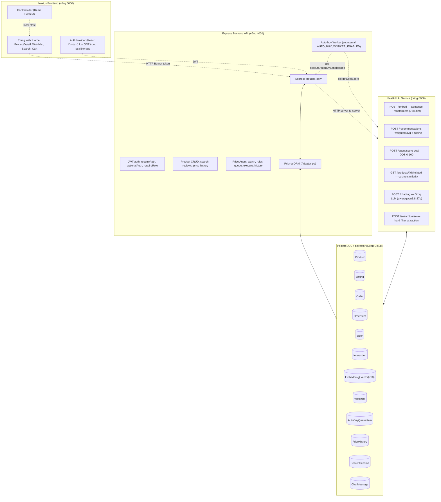
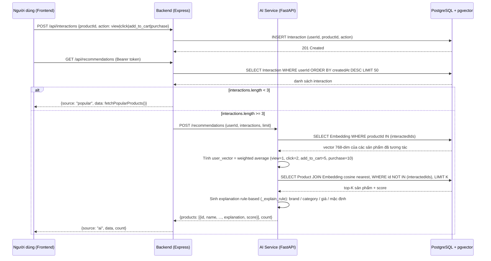

# ARCHITECTURE — Kiến trúc hệ thống Amora

Tài liệu này mô tả kiến trúc tổng thể của hệ thống E-commerce AI-driven "Amora". Nguyên liệu viết **Chương 3 (System Design)** của báo cáo đồ án.

---

## 1. Tổng quan kiến trúc 3 lớp

Hệ thống chia thành 3 dịch vụ chạy độc lập, giao tiếp qua HTTP/REST:

| Lớp | Dịch vụ | Công nghệ | Cổng |
|-----|---------|-----------|------|
| Frontend | Next.js (App Router) | React, Tailwind CSS, shadcn/ui | 3000 |
| Backend API | Express (Node.js, TypeScript) | Prisma ORM, JWT, Swagger | 4000 |
| AI Service | FastAPI (Python 3.11+) | Sentence-Transformers, pgvector, Groq LLM | 8000 |
| Database | PostgreSQL + pgvector | Neon Cloud | — |

### Mermaid: Sơ đồ kiến trúc 3 lớp



---

## 2. Data Flow của 3 tính năng AI chính

### 2.1 Semantic Search + Personalized Recommendation

Luồng dữ liệu từ tương tác người dùng đến gợi ý cá nhân hóa:



**Các thành phần chính:**
- `INTERACTION_WEIGHTS` trong `AI_features/main.py`: `view=1`, `click=2`, `add_to_cart=5`, `purchase=10`.
- `_explain_rule()` trong `AI_features/main.py`: ưu tiên brand (`"Vì bạn quan tâm {brand}"`), sau đó category (`"Cùng danh mục {category}"`), sau đó giá (`"Hợp ngân sách của bạn"`), mặc định `"Phù hợp với sở thích"`.
- Backend `GET /api/recommendations` (`backend/src/index.ts`): `requireAuth`, lấy 50 interaction gần nhất, nếu `< 3` → popular fallback, nếu `≥ 3` → gọi AI service với timeout `AI_TIMEOUT_MS` (mặc định 2000ms), fail-safe về popular khi AI lỗi. `limit` cap ở 50 (`RECOMMENDATIONS_MAX_LIMIT`), mặc định 12 (`RECOMMENDATIONS_DEFAULT_LIMIT`).

### 2.2 RAG Chatbot

Luồng tư vấn mua hàng qua Groq LLM:

```mermaid
sequenceDiagram
    participant U as Người dùng
    participant A as AI Service (FastAPI)
    participant DB as PostgreSQL
    participant G as Groq LLM (qwen/qwen3.8-27b)

    U->>A: POST /chat/rag {sessionId, message}
    A->>DB: INSERT ChatMessage (role='user', content=message)
    A->>A: Kiểm tra greeting (từ khóa chào hoặc độ dài <= 3) → is_greeting
    alt not greeting
        A->>DB: SELECT Product WHERE hard-filter (category, brand, price range) LIMIT 3
        DB-->>A: danh sách sản phẩm khớp
        alt không có sản phẩm khớp
            A-->>U: {"answer": "Dạ hiện tại shop không có sản phẩm nào phù hợp..."}
        else có sản phẩm khớp
            A->>G: Tạo system prompt với danh sách sản phẩm + search intent
            G-->>A: câu trả lời tư vấn tự nhiên
            A->>DB: INSERT ChatMessage (role='assistant', content=answer, retrievedProducts=Json)
            A-->>U: {answer, products, groundedness_score: 0.95}
    end
```

**Các thành phần chính:**
- `parse_filters()` trong `AI_features/main.py`: bóc tách `min_price`, `max_price`, `category_id`, `brand`, `strict_budget` từ văn bản tiếng Việt (hỗ trợ đơn vị: triệu, tr, củ, k, nghìn, ngàn).
- Hỗ trợ context retention: kế thừa danh mục từ tin nhắn gần nhất trong `chat_history`.
- LLM model: `qwen/qwen3.8-27b` qua OpenAI client trỏ tới `https://api.groq.com/openai/v1` với `GROQ_API_KEY`.
- Anti-hallucination: nếu không có sản phẩm khớp hard filter, bỏ qua LLM và trả lời ngay.

### 2.3 Price Agent (Monitor → DQS Score → Queue → Auto-buy Worker)

```mermaid
sequenceDiagram
    participant U as Người dùng (Frontend /watchlist)
    participant B as Backend (Express)
    participant A as AI Service (FastAPI)
    participant DB as PostgreSQL
    participant W as Auto-buy Worker (setInterval)

    U->>B: POST /api/agent/watch {product_id, target_price}
    B->>DB: INSERT Watchlist (userId, productId, targetPrice, status='active')
    DB-->>B: watch created

    U->>B: PUT /api/agent/rules {auto_buy: true}
    B->>DB: UPDATE User SET autoBuyEnabled = true WHERE id = userId

    U->>B: POST /api/agent/queue {watch_id}
    B->>DB: INSERT AutoBuyQueueItem (watchlistId, status='pending', result=NULL)
    DB-->>B: queue item created

    loop mỗi AUTO_BUY_WORKER_INTERVAL_MS (mặc định 10000ms, dev dùng 60000ms)
        W->>B: SELECT AutoBuyQueueItem WHERE status='pending' AND watchlist.active AND user.autoBuyEnabled
        W->>A: POST /agent/score-deal {productId, currentPrice}
        A->>DB: SELECT Product.originalPrice, discountPercent, rating
        A->>DB: SELECT MIN(price), MAX(price) FROM PriceHistory JOIN Listing WHERE productId AND recordedAt >= 30 days ago
        A->>A: Tính DQS = discount_score(40) + history_score(40) + rating_score(20), clamp 0-100
        A-->>W: {dqs, is_deal, breakdown}
        W->>B: executeAutoBuySandboxJob()
        
        alt dqs < 70
            B->>DB: UPDATE AutoBuyQueueItem SET status='rejected', result.reason='dqs_too_low'
        alt currentPrice > targetPrice
            B->>DB: UPDATE AutoBuyQueueItem SET status='rejected', result.reason='over_budget'
        alt không có listing
            B->>DB: UPDATE AutoBuyQueueItem SET status='rejected', result.reason='no_available_listing'
        else happy path
            B->>DB: INSERT Order (status='sandbox', paymentMethod='cod', shippingInfo={autoBuy:true, watchlistId})
            B->>DB: INSERT OrderItem
            B->>DB: UPDATE AutoBuyQueueItem SET status='completed', result.order_id=order.id
        end
    end

    U->>B: POST /api/agent/queue/:id/execute (trigger thủ công, không cần đợi worker)
    B->>B: executeAutoBuySandboxJob() (cùng logic trên)
    B-->>U: {status: completed|rejected, result: {...}}
```

**Các thành phần chính:**
- `getDealScore()` trong `backend/src/index.ts`: gọi `AI_URL/agent/score-deal` với timeout 3000ms.
- `executeAutoBuySandboxJob()` trong `backend/src/index.ts`: transaction Prisma, kiểm tra `autoBuyEnabled`, `watchlist.status='active'`, DQS ≥ 70, `currentPrice ≤ targetPrice`, sau đó tạo `Order` status `sandbox`.
- `runAutoBuyWorker()` trong `backend/src/index.ts`: `setInterval`, batch size `AUTO_BUY_WORKER_BATCH_SIZE`, processed FIFO (`ORDER BY createdAt ASC, id ASC`).
- `startAutoBuyWorker()` trong `backend/src/index.ts`: chỉ chạy nếu `AUTO_BUY_WORKER_ENABLED === 'true'`.

---

## 3. Mô tả chi tiết các bảng Database chính

Tất cả bảng được định nghĩa trong `backend/prisma/schema.prisma`, sử dụng PostgreSQL với extension `pgvector`.

### 3.1 Bảng người dùng và đơn hàng

| Bảng | Cột chính | Mô tả |
|------|-----------|-------|
| `User` | `id` (uuid, PK), `email` (unique), `passwordHash`, `role` (buyer/seller), `autoBuyEnabled` (boolean, default false), `createdAt` | Tài khoản người dùng. `autoBuyEnabled` bật/tắt tính năng mua tự động. |
| `Order` | `id` (uuid, PK), `buyerId` (FK → User), `totalAmount` (float), `status` (pending/processing/shipped/delivered/cancelled), `shippingInfo` (JSON), `paymentMethod` (default 'cod'), `createdAt` | Đơn hàng. Order sandbox từ Price Agent có `status='sandbox'`. |
| `OrderItem` | `id` (uuid, PK), `orderId` (FK), `listingId` (FK), `quantity` (int), `price` (float) | Chi tiết đơn hàng. |
| `Review` | `id` (uuid, PK), `productId` (FK → Product), `userId` (FK → User), `rating` (int), `comment` (string?), `isFake` (boolean, default false), `createdAt` | Đánh giá sản phẩm của buyer. Dùng để tính average rating của Product. |

### 3.2 Bảng sản phẩm và danh mục

| Bảng | Cột chính | Mô tả |
|------|-----------|-------|
| `Category` | `id` (uuid, PK), `name`, `slug` (unique) | Danh mục sản phẩm (ví dụ: cat-laptop, cat-phone). |
| `Product` | `id` (uuid, PK), `categoryId` (FK), `name`, `description`, `specs` (JSON), `basePrice` (float), `rating` (float, default 0), `reviewCount` (int, default 0), `originalPrice` (float, default 0), `discountPercent` (int, default 0), `tags` (string[]), `images` (string[]), `imageUrl`, `brand` | Sản phẩm chính. Các trường `rating`, `reviewCount`, `originalPrice`, `discountPercent` được thêm để hỗ trợ Price Agent và hiển thị giảm giá. |
| `Listing` | `id` (uuid, PK), `productId` (FK → Product), `shopId` (FK → Shop), `price` (float), `stock` (int), `condition` (default 'new'), `createdAt` | Listing bán hàng của shop. Một product có nhiều listing. |
| `Shop` | `id` (uuid, PK), `sellerId` (String), `name`, `description`, `reputationScore` (float, default 0), `createdAt` | Cửa hàng của seller. Một shop có nhiều listing. |

### 3.3 Bảng tương tác và tìm kiếm

| Bảng | Cột chính | Mô tả |
|------|-----------|-------|
| `Interaction` | `id` (uuid, PK), `userId` (FK → User), `productId` (FK → Product), `action` (view/click/add_to_cart/purchase), `createdAt` | Ghi nhận hành động người dùng. Dùng để tính user vector cho Personalized Feed. |
| `SearchSession` | `id` (uuid, PK), `userId` (nullable FK), `queryText`, `filters` (JSON), `createdAt` | Phiên tìm kiếm ngôn ngữ tự nhiên. |
| `SearchClick` | `id` (uuid, PK), `sessionId` (FK), `productId` (FK → Product), `createdAt` | Click vào sản phẩm trong kết quả tìm kiếm. |
| `ChatMessage` | `id` (uuid, PK), `sessionId` (FK → SearchSession), `role` (user/assistant), `content` (string), `retrievedProducts` (JSON?), `createdAt` | Tin nhắn trong phiên chat RAG. Lưu câu hỏi user và câu trả lời assistant kèm sản phẩm được truy xuất. |

### 3.4 Bảng AI & Agent (Price Agent)

| Bảng | Cột chính | Mô tả |
|------|-----------|-------|
| `Embedding` | `id` (uuid, PK), `productId` (FK → Product), `vector` (vector(768), Unsupported type), `updatedAt` | Embedding vector 768 chiều của sản phẩm, dùng cho cosine similarity. |
| `Watchlist` | `id` (uuid, PK), `userId` (FK → User), `productId` (FK → Product), `targetPrice` (float), `status` (default 'active'), `createdAt` | Giá mục tiêu người dùng theo dõi. |
| `AutoBuyQueueItem` | `id` (uuid, PK), `watchlistId` (FK → Watchlist), `status` (pending/processing/completed/rejected, default 'pending'), `result` (JSON), `createdAt` | Hàng đợi mua tự động sandbox. `result` chứa DQS, lý do, order_id nếu thành công. |
| `PriceHistory` | `id` (uuid, PK), `listingId` (FK → Listing), `price` (float), `recordedAt` (datetime), | Lịch sử biến động giá của mỗi listing. Dùng để tính `history_score` trong DQS. |

**Index quan trọng:**
- `Product(@@index([categoryId]))`
- `Listing(@@index([productId, stock, price]))`, `(@@index([shopId]))`
- `Interaction(@@index([userId, createdAt]))`
- `Embedding` có pgvector index (HNSW) qua `previewFeatures = ["postgresqlExtensions"]`
- `Watchlist(@@index([userId, createdAt]))`
- `AutoBuyQueueItem(@@index([status, createdAt]))`, `(@@index([watchlistId, status]))`
- `PriceHistory(@@index([listingId, recordedAt]))`
- `Order(@@index([buyerId, createdAt]))`

---

## 4. Công nghệ và biến môi trường chính

| Biến | Nơi dùng | Mô tả |
|------|----------|-------|
| `DATABASE_URL` | Backend, AI Service | Chuỗi kết nối PostgreSQL (Neon, sslmode=require). |
| `JWT_SECRET` | Backend | Khóa ký JWT (production bắt buộc ≥ 32 bytes). |
| `AI_URL` | Backend | URL AI Service (mặc định `http://localhost:8000`). |
| `AI_TIMEOUT_MS` | Backend | Timeout gọi AI service cho recommendations (mặc định 2000ms). |
| `AUTO_BUY_WORKER_ENABLED` | Backend | Bật/tắt worker auto-buy (`true`/`false`). |
| `AUTO_BUY_WORKER_INTERVAL_MS` | Backend | Khoảng thời gian chạy worker (tối thiểu 1000ms). |
| `AUTO_BUY_WORKER_BATCH_SIZE` | Backend | Số lượng item xử lý mỗi lần worker (1–100). |
| `GROQ_API_KEY` | AI Service | API key cho Groq LLM (qwen/qwen3.8-27b). |
| `NVIDIA_API_KEY` | AI Service | (Đã cấu hình trong .env, hiện chưa dùng trong main.py). |

---

## 5. Ràng buộc bảo mật và khả năng mở rộng

- **Authentication**: JWT HS256, verify payload qua database trên mỗi request protected (`requireAuth`). `optionalAuth` dùng cho interaction và search sessions (cho phép anonymous với `mock-user-123`).
- **Authorization**: `requireRole(['buyer'])` / `requireRole(['seller'])` cho các endpoint phân quyền.
- **Rate limit**: 300 req/15 phút cho `/api`, 10 req/15 phút cho auth (express-rate-limit, in-memory store).
- **Sandbox**: Price Agent chỉ mô phỏng quyết định mua, không tạo đơn hàng thật hay gọi cổng thanh toán. Order tạo ra có `status='sandbox'`.
- **Rate-limit cluster**: Cần shared store (Redis) khi triển khai nhiều instance backend.

---