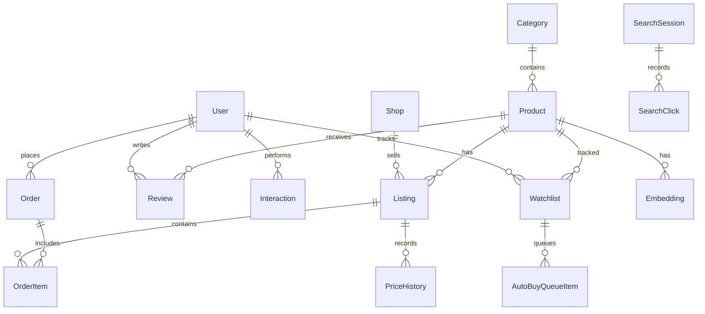
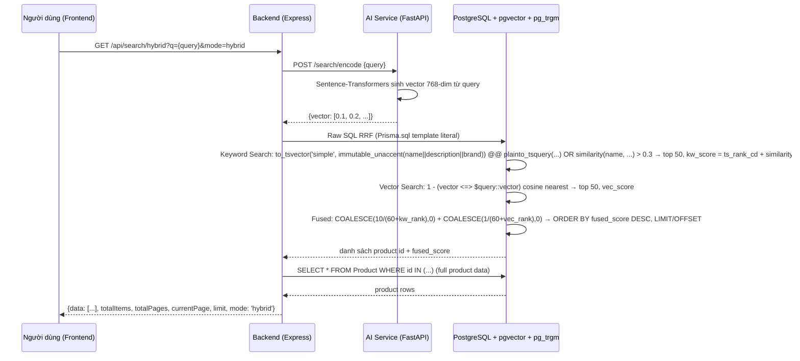
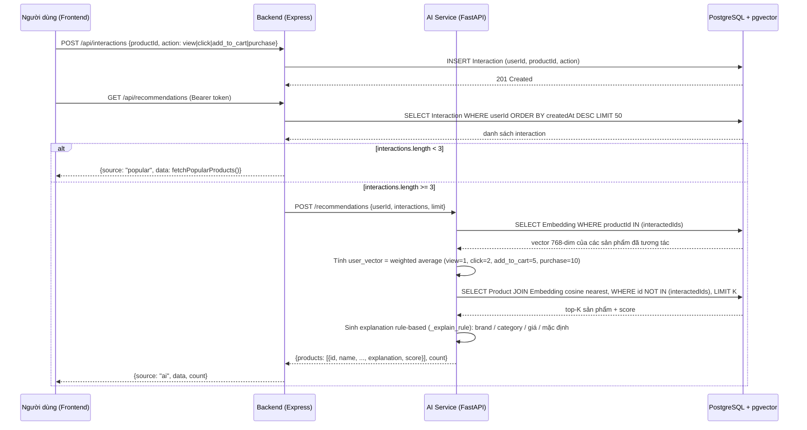

# ARCHITECTURE — Kiến trúc hệ thống Amora (AI-Driven E-commerce)

Tài liệu này mô tả kiến trúc tổng thể của hệ thống E-commerce AI-driven "Amora". Nguyên liệu viết Chương 3 (System Design) của báo cáo đồ án. Mọi thông số, tên hàm, endpoint trong docs này được trích xuất trực tiếp từ code hiện tại (`backend/src/index.ts`, `AI_features/main.py`, `backend/prisma/schema.prisma`).

<!-- Source: backend/src/index.ts, AI_features/main.py, backend/prisma/schema.prisma -->

---

## 1. Tổng quan kiến trúc 3 lớp (3-Tier Architecture)

Hệ thống chia thành 4 thành phần chạy độc lập, giao tiếp qua HTTP/REST:

| Thành phần | Công nghệ | Cổng | Vai trò |
|------------|-----------|------|---------|
| Frontend | Next.js (App Router), React, Tailwind CSS, shadcn/ui | 3000 | Giao diện người dùng: Home, ProductDetail, Watchlist, Search, Cart |
| Backend API | Express (Node.js, TypeScript), Prisma ORM, JWT, Swagger | 4000 | API marketplace, auth, orders, search, price agent, worker |
| AI Service | FastAPI (Python 3.11+), Sentence-Transformers, Groq LLM | 8000 | Embedding, semantic search, RAG chat, DQS, recommendations |
| Database | PostgreSQL + pgvector (Neon Cloud) | — | Lưu dữ liệu sản phẩm, đơn hàng, embedding, lịch sử giá |

<!-- Source: backend/src/index.ts dòng 1-62, AI_features/main.py dòng 19-38, backend/prisma/schema.prisma -->

### Mermaid: Sơ đồ kiến trúc 3 lớp


<!-- Source: backend/src/index.ts dòng 444-506, 1990-2350; AI_features/main.py dòng 1-1008 -->

### 1.1 Biến môi trường chính

| Biến | Nơi dùng | Mô tả |
|------|----------|-------|
| `DATABASE_URL` | Backend, AI Service | Chuỗi kết nối PostgreSQL (Neon, sslmode=require) |
| `JWT_SECRET` | Backend | Khóa ký JWT (production bắt buộc ≥ 32 bytes) |
| `AI_URL` | Backend | URL AI Service (mặc định `http://localhost:8000`) |
| `AI_TIMEOUT_MS` | Backend | Timeout gọi AI service (mặc định 2000ms) |
| `AUTO_BUY_WORKER_ENABLED` | Backend | Bật/tắt worker auto-buy (`true`/`false`) |
| `AUTO_BUY_WORKER_INTERVAL_MS` | Backend | Khoảng thời gian chạy worker (tối thiểu 1000ms, dev 60000ms) |
| `AUTO_BUY_WORKER_BATCH_SIZE` | Backend | Số lượng item xử lý mỗi lần worker (1–100) |
| `GROQ_API_KEY` | AI Service | API key cho Groq LLM (qwen/qwen3.8-27b) |

<!-- Source: backend/src/index.ts dòng 56-73; AI_features/main.py dòng 35-38 -->

---

## 2. Database Schema & ERD

Tất cả bảng được định nghĩa trong `backend/prisma/schema.prisma`, sử dụng PostgreSQL với extension `pgvector`.

### 2.1 ERD (Entity Relationship Diagram)



<!-- Source: backend/prisma/schema.prisma dòng 11-204 -->

### 2.2 Mô tả chi tiết các bảng chính

| Bảng | Cột chính | Mô tả |
|------|-----------|-------|
| `User` | `id` (uuid PK), `email` (unique), `passwordHash`, `role` (buyer/seller), `autoBuyEnabled` (boolean, default false), `createdAt` | Tài khoản người dùng. `autoBuyEnabled` bật/tắt tính năng mua tự động. |
| `Shop` | `id` (uuid PK), `sellerId`, `name`, `description`, `reputationScore` (float, default 0) | Cửa hàng của seller. |
| `Category` | `id` (uuid PK), `name`, `slug` (unique) | Danh mục sản phẩm (ví dụ: cat-laptop, cat-phone). |
| `Product` | `id` (uuid PK), `categoryId` (FK), `name`, `description`, `specs` (JSON), `basePrice` (float), `rating` (float, default 0), `reviewCount` (int, default 0), `originalPrice` (float, default 0), `discountPercent` (int, default 0), `tags` (string[]), `images` (string[]), `imageUrl`, `brand` | Sản phẩm chính. |
| `Listing` | `id` (uuid PK), `productId` (FK → Product), `shopId` (FK → Shop), `price` (float), `stock` (int), `condition` (default 'new'), `createdAt` | Listing bán hàng của shop. Một product có nhiều listing. |
| `Order` | `id` (uuid PK), `buyerId` (FK → User), `totalAmount` (float), `status` (pending/processing/shipped/delivered/cancelled/sandbox), `shippingInfo` (JSON), `paymentMethod` (default 'cod'), `createdAt` | Đơn hàng. Order sandbox từ Price Agent có `status='sandbox'`. |
| `OrderItem` | `id` (uuid PK), `orderId` (FK), `listingId` (FK), `quantity` (int), `price` (float) | Chi tiết đơn hàng. |
| `Review` | `id` (uuid PK), `productId` (FK → Product), `userId` (FK → User), `rating` (int), `comment`, `isFake` (boolean, default false), `createdAt` | Đánh giá sản phẩm. |
| `Interaction` | `id` (uuid PK), `userId` (FK → User), `productId` (FK → Product), `action` (view/click/add_to_cart/purchase), `createdAt` | Ghi nhận hành động người dùng. |
| `Embedding` | `id` (uuid PK), `productId` (FK → Product), `vector` (vector(768)), `updatedAt` | Embedding vector 768 chiều của sản phẩm. |
| `Watchlist` | `id` (uuid PK), `userId` (FK → User), `productId` (FK → Product), `targetPrice` (float), `status` (default 'active'), `createdAt` | Giá mục tiêu người dùng theo dõi. |
| `AutoBuyQueueItem` | `id` (uuid PK), `watchlistId` (FK → Watchlist), `status` (pending/processing/completed/rejected, default 'pending'), `result` (JSON), `createdAt` | Hàng đợi mua tự động sandbox. |
| `PriceHistory` | `id` (uuid PK), `listingId` (FK → Listing), `price` (float), `recordedAt` (datetime) | Lịch sử biến động giá của mỗi listing. |
| `SearchSession` | `id` (uuid PK), `userId` (nullable FK), `queryText`, `filters` (JSON), `createdAt` | Phiên tìm kiếm ngôn ngữ tự nhiên. |
| `ChatMessage` | `id` (uuid PK), `sessionId` (FK), `role` (user/assistant), `content`, `retrievedProducts` (JSON), `createdAt` | Tin nhắn trong phiên chat RAG. |

### 2.3 Index quan trọng

- `Product(@@index([categoryId]))`
- `Listing(@@index([productId, stock, price]))`, `(@@index([shopId]))`
- `Interaction(@@index([userId, createdAt]))`
- `Watchlist(@@index([userId, createdAt]))`
- `AutoBuyQueueItem(@@index([status, createdAt]))`, `(@@index([watchlistId, status]))`
- `PriceHistory(@@index([listingId, recordedAt]))`
- `Order(@@index([buyerId, createdAt]))`
- `Embedding` có pgvector index (HNSW) qua `previewFeatures = ["postgresqlExtensions"]`

<!-- Source: backend/prisma/schema.prisma -->

---

## 3. Data Flow của 4 tính năng AI chính (Sequence Diagrams)

### 3.1 Hybrid Search (Keyword FTS + Vector + RRF)

Luồng tìm kiếm sản phẩm kết hợp từ khóa và ngữ nghĩa:



**Thành phần chính:**
- `POST /search/encode` trong `AI_features/main.py` dòng 69-76: nhận query string, trả về vector 768-dim qua Sentence-Transformers `keepitreal/vietnamese-sbert`.
- `GET /api/search/hybrid` trong `backend/src/index.ts` dòng 1205-1565: dùng `Prisma.sql` template literal, xây dựng `filterConditions` động, chạy `dataQuery` (RRF) và `countQuery` song song qua `Promise.all`.
- Migration cài extension `pg_trgm`, `unaccent`; tạo hàm `immutable_unaccent(text)` marked `IMMUTABLE PARALLEL SAFE STRICT`; tạo GIN FTS index, GIN trigram indexes, HNSW index (`vector_cosine_ops`).
- Tìm kiếm sai chính tả: `pg_trgm` `similarity(p."name", ...) > 0.3` trong WHERE clause.
- `Exact Match Boost`: +1000 vào `fused_score` đối với sản phẩm tên chứa chuỗi truy vấn (substring match).
- Cache: `node-cache` (stdTTL 300s) lưu kết quả `GET /api/search/hybrid` theo `req.originalUrl`.

<!-- Source: backend/src/index.ts dòng 1205-1565; AI_features/main.py dòng 69-76 -->

### 3.2 Personalized Recommendation (Stage 1)

Luồng dữ liệu từ tương tác người dùng đến gợi ý cá nhân hóa:



**Thành phần chính:**
- `INTERACTION_WEIGHTS` trong `AI_features/main.py` dòng 104-109: `view=1`, `click=2`, `add_to_cart=5`, `purchase=10`.
- `_explain_rule()` trong `AI_features/main.py` dòng 127-135: ưu tiên brand (`"Vì bạn quan tâm {brand}"`), sau đó category (`"Cùng danh mục {category}"`), sau đó giá (`"Hợp ngân sách của bạn"`), mặc định `"Phù hợp với sở thích"`.
- Backend `GET /api/recommendations` (`backend/src/index.ts` dòng 2521-2586): `requireAuth`, lấy 50 interaction gần nhất, nếu `< 3` → popular fallback, nếu `≥ 3` → gọi AI service với timeout `AI_TIMEOUT_MS` (mặc định 2000ms), fail-safe về popular khi AI lỗi. `limit` cap ở 50 (`RECOMMENDATIONS_MAX_LIMIT`), mặc định 12 (`RECOMMENDATIONS_DEFAULT_LIMIT`).

<!-- Source: AI_features/main.py dòng 104-135, 858-998; backend/src/index.ts dòng 2486-2586 -->

### 3.3 RAG Chatbot (Groq LLM qwen/qwen3.8-27b)

Luồng tư vấn mua hàng qua Groq LLM:

```mermaid
sequenceDiagram
    participant U as Người dùng
    participant A as AI Service (FastAPI)
    participant DB as PostgreSQL
    participant G as Groq LLM (qwen/qwen3.8-27b)

    U->>A: POST /chat/rag {sessionId, message}
    A->>DB: INSERT ChatMessage (role='user', content=message)
    A->>A: Kiểm tra greeting (từ khóa chào hoặc độ dài <= 3) → is_greeting
    alt not greeting
        A->>DB: SELECT Product WHERE hard-filter (category, brand, price range) LIMIT 3
        DB-->>A: danh sách sản phẩm khớp
        alt không có sản phẩm khớp
            A-->>U: {"answer": "Dạ hiện tại shop không có sản phẩm nào phù hợp..."}
        else có sản phẩm khớp
            A->>G: Tạo system prompt với danh sách sản phẩm + search intent
            G-->>A: câu trả lời tư vấn tự nhiên
            A->>DB: INSERT ChatMessage (role='assistant', content=answer, retrievedProducts=Json)
            A-->>U: {answer, products, groundedness_score: 0.95}
    end
```

**Thành phần chính:**
- `parse_filters()` trong `AI_features/main.py` dòng 190-280: bóc tách `min_price`, `max_price`, `category_id`, `brand`, `strict_budget` từ văn bản tiếng Việt (hỗ trợ đơn vị: triệu, tr, củ, k, nghìn, ngàn).
- Hỗ trợ context retention: kế thừa danh mục từ tin nhắn gần nhất trong `chat_history`.
- LLM model: `qwen/qwen3.8-27b` qua OpenAI client trỏ tới `https://api.groq.com/openai/v1` với `GROQ_API_KEY` (`AI_features/main.py` dòng 525-528, 578-587).
- Anti-hallucination: nếu không có sản phẩm khớp hard filter, bỏ qua LLM và trả lời ngay (`AI_features/main.py` dòng 478-492).
- `groundedness_score` trả về hardcode `0.95` (`AI_features/main.py` dòng 633).

<!-- Source: AI_features/main.py dòng 382-634 -->

### 3.4 Price Agent & Auto-buy Worker (DQS → Queue → Execute)

Luồng tự động theo dõi giá và mua tự động sandbox:

```mermaid
sequenceDiagram
    participant U as Người dùng (Frontend /watchlist)
    participant B as Backend (Express)
    participant A as AI Service (FastAPI)
    participant DB as PostgreSQL
    participant W as Auto-buy Worker (setInterval)

    U->>B: POST /api/agent/watch {product_id, target_price}
    B->>DB: INSERT Watchlist (userId, productId, targetPrice, status='active')
    DB-->>B: watch created

    U->>B: PUT /api/agent/rules {auto_buy: true}
    B->>DB: UPDATE User SET autoBuyEnabled = true WHERE id = userId

    U->>B: POST /api/agent/queue {watch_id}
    B->>DB: INSERT AutoBuyQueueItem (watchlistId, status='pending', result=NULL)
    DB-->>B: queue item created

    loop mỗi AUTO_BUY_WORKER_INTERVAL_MS (mặc định 10000ms, dev 60000ms)
        W->>B: SELECT AutoBuyQueueItem WHERE status='pending' AND watchlist.active AND user.autoBuyEnabled
        W->>A: POST /agent/score-deal {productId, currentPrice}
        A->>DB: SELECT Product.originalPrice, discountPercent, rating
        A->>DB: SELECT MIN(price), MAX(price) FROM PriceHistory JOIN Listing WHERE productId AND recordedAt >= 30 days ago
        A->>A: Tính DQS = discount_score(40) + history_score(40) + rating_score(20), clamp 0-100
        A-->>W: {dqs, is_deal, breakdown}
        W->>B: executeAutoBuySandboxJob()

        alt dqs < 70
            B->>DB: UPDATE AutoBuyQueueItem SET status='rejected', result.reason='dqs_too_low'
        alt currentPrice > targetPrice
            B->>DB: UPDATE AutoBuyQueueItem SET status='rejected', result.reason='over_budget'
        alt không có listing
            B->>DB: UPDATE AutoBuyQueueItem SET status='rejected', result.reason='no_available_listing'
        else happy path
            B->>DB: INSERT Order (status='sandbox', paymentMethod='cod', shippingInfo={autoBuy:true, watchlistId})
            B->>DB: INSERT OrderItem
            B->>DB: UPDATE AutoBuyQueueItem SET status='completed', result.order_id=order.id
        end
    end

    U->>B: POST /api/agent/queue/:id/execute (trigger thủ công)
    B->>B: executeAutoBuySandboxJob() (cùng logic trên)
    B-->>U: {status: completed|rejected, result: {...}}
```

**Thành phần chính:**
- `getDealScore()` trong `backend/src/index.ts` dòng 1990-2019: gọi `AI_URL/agent/score-deal` với timeout 5000ms, cache DQS theo `(product_id, current_price)` TTL 120s (`dqsCache`).
- `executeAutoBuySandboxJob()` trong `backend/src/index.ts` dòng 2021-2199: transaction Prisma, kiểm tra `autoBuyEnabled`, `watchlist.status='active'`, DQS ≥ 70, `currentPrice ≤ targetPrice`, sau đó tạo `Order` status `sandbox`.
- `runAutoBuyWorker()` trong `backend/src/index.ts` dòng 2266-2337: `setInterval`, batch size `AUTO_BUY_WORKER_BATCH_SIZE`, processed FIFO (`ORDER BY createdAt ASC, id ASC`), heartbeat log `pending_before` / `pending_after`.
- `autoEnqueueWatchlistHits()` trong `backend/src/index.ts` dòng 2214-2264: quét tất cả watchlist active của user có `autoBuyEnabled=true`, nếu `currentPrice ≤ targetPrice` và `dqs ≥ 70` thì tạo queue item mới.
- `startAutoBuyWorker()` trong `backend/src/index.ts` dòng 2339-2350: chỉ chạy nếu `AUTO_BUY_WORKER_ENABLED === 'true'`.

<!-- Source: backend/src/index.ts dòng 1990-2350 -->

### 3.5 Thuật toán Deal Quality Score (DQS)

Công thức tính DQS 0-100 trong `AI_features/main.py` dòng 652-735:

- **Discount Score (40 điểm)**: `% giảm so với originalPrice`. Discount ≥ 20% → 40; Discount ≤ 5% → 0; trung gian scale tuyến tính.
- **History Score (40 điểm)**: Vị trí của `currentPrice` trong khoảng `[minPrice, maxPrice]` 30 ngày qua (qua `PriceHistory`). `currentPrice ≤ minPrice * 1.05` → 40; `currentPrice ≥ maxPrice` → 0; trung gian scale. Không có lịch sử giá → trung bình 20 điểm.
- **Rating Score (20 điểm)**: Rating của product. Rating ≥ 4.5 → 20; Rating ≤ 3.0 → 0; trung gian scale tuyến tính.
- `dqs = round(discount_score + history_score + rating_score)`, clamp 0-100.
- `is_deal = dqs >= 70`.

<!-- Source: AI_features/main.py dòng 652-735 -->

---

## 4. Công nghệ và luồng yêu cầu kỹ thuật (Non-functional)

### 4.1 Authentication & Authorization
- JWT HS256, verify payload qua database trên mỗi request protected (`requireAuth`, `backend/src/index.ts` dòng 444-485).
- `optionalAuth` dùng cho interaction và search sessions (cho phép anonymous với `mock-user-123`).
- `requireRole(['buyer'])` / `requireRole(['seller'])` cho các endpoint phân quyền.

### 4.2 Rate limiting & Caching
- Rate limit: 300 request / 15 phút trên tất cả `/api`; 10 request / 15 phút cho register/login (`express-rate-limit`, in-memory store).
- `node-cache` (stdTTL 300s) cache `GET /api/products`, `GET /api/search/hybrid`.
- `dqsCache` (stdTTL 120s) cache DQS theo `(product_id, current_price)`.

### 4.3 Sandbox mode
- Price Agent chỉ mô phỏng quyết định mua, không tạo đơn hàng thật hay gọi cổng thanh toán. Order tạo ra có `status='sandbox'`.

### 4.4 Ràng buộc bảo mật và khả năng mở rộng
- Email tối đa 254 ký tự; mật khẩu 8–72 UTF-8 bytes.
- JSON request body giới hạn 100 KB.
- Rate-limit cluster: Cần shared store (Redis) khi triển khai nhiều instance backend.

<!-- Source: backend/src/index.ts dòng 168-181, 508-533, 545-555 -->